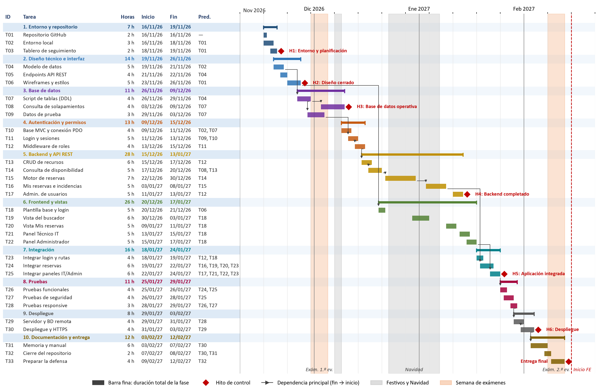

# Plan de ejecución del proyecto — WorkSpace IT

**Alumno:** Adrián Martínez Alarcón  
**Ciclo:** 2.º CFGS Desarrollo de Aplicaciones Web (DAW) · **Curso:** 2026/2027

---

## 1. Resumen y alcance

**WorkSpace IT** es una aplicación web pensada para pequeñas y medianas empresas tecnológicas con trabajo híbrido (*hot-desking*). Permite gestionar desde un mismo lugar la reserva de puestos rotativos, salas de reuniones y el préstamo de equipamiento informático y ergonómico compartido.

### Perfiles de usuario
- **Empleado:** consulta la disponibilidad, realiza y cancela reservas y avisa de averías.
- **Responsable de recursos / Técnico IT:** mantiene el catálogo de espacios y equipos, revisa el historial y pone equipos en mantenimiento.
- **Administrador:** gestiona los usuarios y sus roles y configura los horarios y los límites de reserva.

---

## 2. Descomposición en tareas y cronograma (T01–T33)

El desarrollo se estructura en **10 bloques** y **33 tareas** (146 horas de ejecución entre el **16/11/2026** y el **12/02/2027**).

### Bloque 1. Entorno y repositorio (7 h · 16/11/2026 – 19/11/2026)
| ID | Tarea | Descripción | Horas | Inicio | Fin | Pred. | Resultado verificable |
|---|---|---|---|---|---|---|---|
| **T01** | Crear y organizar el repositorio GitHub | Crear el repositorio, el `.gitignore`, las carpetas `src/`, `docs/` y `sql/` y el `README.md` inicial. | 2 h | 16/11/26 | 16/11/26 | — | Repositorio accesible con estructura base y primer commit. |
| **T02** | Configurar el entorno de desarrollo local | Instalar y ajustar VS Code, Laragon (PHP 8 y MySQL/MariaDB) y DBeaver. | 3 h | 16/11/26 | 18/11/26 | T01 | `localhost` responde y hay conexión con MySQL. |
| **T03** | Preparar el tablero de seguimiento | Crear el tablero Kanban en GitHub Projects, las etiquetas de Issues y cargar las tareas. | 2 h | 18/11/26 | 19/11/26 | T01 | Tablero con las 33 tareas e hitos creados. |

### Bloque 2. Diseño técnico e interfaz (14 h · 19/11/2026 – 26/11/2026)
| ID | Tarea | Descripción | Horas | Inicio | Fin | Pred. | Resultado verificable |
|---|---|---|---|---|---|---|---|
| **T04** | Cerrar el modelo de datos (E-R y relacional) | Definir entidades (`usuarios`, `roles`, `zonas`, `recursos`, `reservas`, `incidencias`, `parametros`), claves e índices. | 5 h | 19/11/26 | 21/11/26 | T02 | `docs/diagrama_bd.pdf` con el E-R y el modelo relacional. |
| **T05** | Definir rutas y endpoints de la API | Rutas, métodos HTTP, parámetros de entrada y formato de las respuestas JSON. | 4 h | 21/11/26 | 22/11/26 | T04 | Documento de endpoints con ejemplos JSON en `docs/`. |
| **T06** | Prototipos de interfaz y guía de estilos | Wireframes en Figma de escritorio y móvil, colores de estado, tipografía y componentes. | 5 h | 23/11/26 | 26/11/26 | T01 | Prototipo navegable en Figma y guía exportada a `docs/`. |

### Bloque 3. Base de datos (11 h · 26/11/2026 – 09/12/2026)
| ID | Tarea | Descripción | Horas | Inicio | Fin | Pred. | Resultado verificable |
|---|---|---|---|---|---|---|---|
| **T07** | Script de creación de tablas | Sentencias `CREATE TABLE` con claves foráneas e índices por fecha. | 4 h | 26/11/26 | 29/11/26 | T04 | `sql/01_schema.sql` se ejecuta sin errores. |
| **T08** | Consulta SQL de solapamientos | Consulta parametrizada que detecta cruces de horario sobre un mismo recurso o empleado. | 4 h | 03/12/26 | 09/12/26 | T07 | Devuelve 0 filas si el tramo está libre y más de 0 si se solapa. |
| **T09** | Script de datos de prueba | `INSERT` con usuarios de los 3 roles, zonas, puestos, salas, equipos y reservas de ejemplo. | 3 h | 29/11/26 | 03/12/26 | T07 | `sql/02_seed.sql` carga datos ficticios coherentes. |

### Bloque 4. Autenticación y permisos (13 h · 09/12/2026 – 15/12/2026)
| ID | Tarea | Descripción | Horas | Inicio | Fin | Pred. | Resultado verificable |
|---|---|---|---|---|---|---|---|
| **T10** | Estructura MVC y conexión a la BD | Carpetas MVC en PHP, clase de conexión PDO con consultas preparadas y lectura del `.env`. | 4 h | 09/12/26 | 11/12/26 | T02, T07 | Conexión PDO funcionando sin credenciales en el código. |
| **T11** | Login, logout y sesiones | Controlador de autenticación con `password_verify` (bcrypt) e inicio y cierre de sesión. | 5 h | 11/12/26 | 13/12/26 | T09, T10 | El login acepta credenciales válidas y rechaza las erróneas. |
| **T12** | Middleware de autorización por roles | Filtro que comprueba en cada ruta privada si el usuario es Empleado, Técnico IT o Admin. | 4 h | 13/12/26 | 15/12/26 | T11 | Devuelve 401/403 ante accesos no autorizados. |

### Bloque 5. Backend y API REST (28 h · 15/12/2026 – 13/01/2027)
| ID | Tarea | Descripción | Horas | Inicio | Fin | Pred. | Resultado verificable |
|---|---|---|---|---|---|---|---|
| **T13** | CRUD de recursos y estados | Alta, listado, edición, baja lógica y cambio de estado (`Disponible` / `Mantenimiento`). | 6 h | 15/12/26 | 17/12/26 | T12 | Endpoints de recursos probados en Postman. |
| **T14** | Endpoint de disponibilidad | Recibe fecha, hora de inicio, hora de fin y categoría y devuelve solo los recursos libres. | 5 h | 17/12/26 | 20/12/26 | T08, T13 | `GET /api/disponibilidad` devuelve el JSON correcto. |
| **T15** | Creación de reservas y reglas | Guardar reservas (puesto o sala + equipo opcional) validando solapamiento, horario y cupo. | 7 h | 22/12/26 | 30/12/26 | T14 | `POST /api/reservas` guarda las válidas y responde 409 si hay solapamiento. |
| **T16** | «Mis reservas» e incidencias | Listar reservas activas e historial, cancelar reservas futuras y registrar averías. | 5 h | 03/01/27 | 08/01/27 | T15 | Se cancela una reserva futura y un equipo pasa a «averiado». |
| **T17** | Administración de usuarios y parámetros | Endpoints del rol Administrador: alta y edición de empleados, roles y límites horarios. | 5 h | 11/01/27 | 13/01/27 | T12 | Cambios de usuarios y parámetros guardados en la BD. |

### Bloque 6. Frontend y vistas (26 h · 20/12/2026 – 17/01/2027)
| ID | Tarea | Descripción | Horas | Inicio | Fin | Pred. | Resultado verificable |
|---|---|---|---|---|---|---|---|
| **T18** | Plantilla base, navegación y login | HTML5 semántico y CSS (Bootstrap) con menú según el rol y pantalla de acceso. | 5 h | 20/12/26 | 21/12/26 | T06 | Login y menú adaptables sin errores en el validador W3C. |
| **T19** | Buscador de disponibilidad y reserva | Filtros de fecha, hora y zona, tarjetas de recursos con su estado y modal de confirmación. | 6 h | 30/12/26 | 03/01/27 | T18 | El buscador pinta tarjetas a partir de datos de prueba. |
| **T20** | Vista «Mis reservas» y averías | Pestañas de reservas activas e historial, botón de cancelar y formulario de incidencias. | 5 h | 09/01/27 | 11/01/27 | T18 | Vista maquetada con validación de formularios en cliente. |
| **T21** | Panel del Técnico IT | Tabla filtrable de inventario, formulario de alta y edición, interruptor de mantenimiento y averías. | 5 h | 13/01/27 | 15/01/27 | T18 | Panel maquetado con controles de estado. |
| **T22** | Panel del Administrador | Listado de empleados, modal de alta y edición con selector de rol y formulario de reglas. | 5 h | 15/01/27 | 17/01/27 | T18 | Panel adaptable a móvil y escritorio. |

### Bloque 7. Integración (16 h · 18/01/2027 – 24/01/2027)
| ID | Tarea | Descripción | Horas | Inicio | Fin | Pred. | Resultado verificable |
|---|---|---|---|---|---|---|---|
| **T23** | Integrar login y redirecciones | Conectar el login con Fetch API y redirigir a cada panel según el rol recibido. | 4 h | 18/01/27 | 19/01/27 | T12, T18 | Cada rol entra en su propio panel. |
| **T24** | Integrar reservas e incidencias | Conectar buscador, modal de reserva y «Mis reservas» con la API, con mensajes de éxito o error. | 6 h | 19/01/27 | 22/01/27 | T16, T19, T20, T23 | Una reserva hecha en el navegador se guarda en MySQL y se ve al momento. |
| **T25** | Integrar paneles de Técnico IT y Admin | Conectar inventario, averías, usuarios y parámetros con la API. Avisos por correo opcionales. | 6 h | 22/01/27 | 24/01/27 | T17, T21, T22, T23 | Las operaciones de IT y Admin funcionan desde la web. |

### Bloque 8. Pruebas (11 h · 25/01/2027 – 29/01/2027)
| ID | Tarea | Descripción | Horas | Inicio | Fin | Pred. | Resultado verificable |
|---|---|---|---|---|---|---|---|
| **T26** | Pruebas funcionales de reglas | Intentar reservar recursos ocupados, en mantenimiento, en fechas pasadas o por encima del cupo. | 4 h | 25/01/27 | 26/01/27 | T24, T25 | Registro de pruebas con todos los casos críticos bloqueados. |
| **T27** | Pruebas de seguridad y validación | Acceso por URL con roles no permitidos, hashes en la BD y envío de campos vacíos o scripts. | 4 h | 26/01/27 | 28/01/27 | T25 | Accesos cruzados bloqueados (403) y formularios validados. |
| **T28** | Pruebas de usabilidad y responsive | Revisión a 1920x1080 y 390x844, etiquetas `label`, contraste y mensajes de error claros. | 3 h | 28/01/27 | 29/01/27 | T26, T27 | Sin desbordamientos ni errores visibles al usuario. |

### Bloque 9. Despliegue (8 h · 29/01/2027 – 03/02/2027)
| ID | Tarea | Descripción | Horas | Inicio | Fin | Pred. | Resultado verificable |
|---|---|---|---|---|---|---|---|
| **T29** | Preparar el servidor y la BD remota | Crear el servicio en Render o Railway, la base de datos MySQL e importar los scripts. | 4 h | 29/01/27 | 31/01/27 | T28 | BD remota accesible desde producción. |
| **T30** | Despliegue, variables de entorno y HTTPS | Vincular el repositorio con el servidor, configurar el `.env` de producción y el certificado. | 4 h | 31/01/27 | 03/02/27 | T29 | Aplicación accesible por URL con HTTPS. |

### Bloque 10. Documentación y entrega (12 h · 03/02/2027 – 12/02/2027)
| ID | Tarea | Descripción | Horas | Inicio | Fin | Pred. | Resultado verificable |
|---|---|---|---|---|---|---|---|
| **T31** | Memoria técnica y manual de usuario | Documento final del proyecto y guía con capturas para los tres perfiles. | 6 h | 03/02/27 | 07/02/27 | T30 | Memoria y manual en `docs/`. |
| **T32** | Revisión y cierre del repositorio | Borrar ramas temporales, fusionar en `main`, etiquetar la `v1.0.0` y actualizar el `README`. | 2 h | 07/02/27 | 08/02/27 | T30, T31 | Versión `v1.0.0` publicada y `README` con la URL de producción. |
| **T33** | Preparar la presentación y la defensa | Presentación, guion de demostración con los tres roles y ensayo. | 4 h | 09/02/27 | 12/02/27 | T32 | Presentación y demo listas para la defensa. |

---

## 3. Hitos de control

- **H1 (19/11/2026):** Entorno, repositorio y tablero preparados (T01–T03).
- **H2 (26/11/2026):** Diseño técnico e interfaz cerrados (T04–T06).
- **H3 (09/12/2026):** Base de datos operativa con datos de prueba (T07–T09).
- **H4 (13/01/2027):** Backend y API REST completos (T10–T17).
- **H5 (24/01/2027):** Aplicación integrada — versión mínima funcional (T18–T25).
- **H6 (03/02/2027):** Aplicación desplegada en producción (T26–T30).
- **Entrega final (12/02/2027):** Memoria, repositorio `v1.0.0` y defensa preparados (T31–T33).

---

## 4. Procedimiento de trabajo

### 4.1. Tablero Kanban (GitHub Projects)
El seguimiento diario se realiza en **GitHub Projects** vinculado al repositorio, organizado en cinco columnas:
1. **Pendiente**
2. **Esta semana**
3. **En curso** *(máximo 2 tareas simultáneas)*
4. **En pruebas**
5. **Terminado**

### 4.2. Control de versiones, ramas y commits
- `main`: versión estable. Solo recibe fusiones al cerrar un hito verificado.
- `develop`: rama de integración donde confluyen las funcionalidades.
- `feature/TXX-descripcion` y `fix/descripcion`: ramas creadas desde `develop` para cada tarea o corrección y fusionadas de vuelta en `develop` al terminar.
- **Formato de commits (Conventional Commits):**
  - `feat(T15): valida en SQL las reservas solapadas`
  - `fix(T12): corrige la redirección del rol Técnico IT`
  - `docs(T04): añade el esquema relacional definitivo`

### 4.3. Criterio de tarea terminada (*Definition of Done*)
Una tarea solo pasa a «Terminado» cuando cumple su resultado verificable y además:
1. El entregable existe (script SQL, endpoint, vista…) y funciona según lo especificado.
2. Si es código de servidor, está probado en Postman con un caso válido y con datos erróneos.
3. Si es una vista, se visualiza correctamente en escritorio y móvil sin errores en consola.
4. El código está limpio, comentado donde corresponde y subido al repositorio remoto (`git push`).

### 4.4. Copias de seguridad
- **Cada sesión (2–4 veces/semana):** `git push` a GitHub del código y scripts SQL.
- **Cada día de trabajo:** copia local en SSD.
- **Quincenal y al cerrar cada hito:** archivo `.zip` del proyecto + volcado `mysqldump` + documentación en OneDrive (cuenta educativa) y Google Drive.

---

## 5. Registro de riesgos y medidas preventivas

### 5.1. Riesgos técnicos y de proyecto
| ID | Riesgo identificado | Prob. | Impacto | Medida preventiva | Actuación si aparece |
|---|---|---|---|---|---|
| **R01** | Fallo en la consulta de solapamientos que permita reservas cruzadas. | Media | Alto | Probar la condición `(inicioNuevo < finExistente AND finNuevo > inicioExistente)` por separado en SQL antes de pasarla a PHP (T08). | Aislar el método, usar transacción para bloquear reservas simultáneas y repetir baterías de prueba. |
| **R02** | Retrasos por coincidir con exámenes o entregas de otros módulos. | Alta | Medio | Planificar menos horas en semanas de evaluación, priorizar funciones esenciales y dejar margen en Navidad. | Reajustar el Gantt y aplazar extras opcionales (avisos SMTP, detalles visuales). |
| **R03** | Dificultad para guardar en una misma reserva un puesto y varios equipos. | Media | Medio | Diseñar en T04 una estructura que compruebe estado y disponibilidad de cada elemento antes de confirmar. | Guardar el préstamo del equipo como registro vinculado inmediatamente después de la reserva principal. |
| **R04** | Problemas de integración: errores de Fetch, sesión perdida o rutas sin proteger. | Media | Alto | Respuestas siempre en JSON con códigos HTTP claros (200, 400, 401, 403, 409) y control de sesión centralizado en T12. | Revisar cabeceras y cookies en Chrome DevTools y verificar el rol al inicio de cada controlador. |
| **R05** | Pérdida de código o base de datos por avería o borrado accidental. | Baja | Alto | Seguir el plan de copias de seguridad (apartado 4.4). | Restaurar el último commit desde GitHub y reconstruir la BD con `01_schema.sql` y `02_seed.sql`. |
| **R06** | Caída, límites o incompatibilidad en el servicio gratuito de despliegue. | Media | Medio | Usar versiones estándar (PHP 8, MySQL 8 / MariaDB 10), variables en `.env` y desplegar con margen. | Migrar a la plataforma alternativa (Render / Railway / Hostinger) importando el SQL y vinculando el repo. |
| **R07** | Dependencia externa que no funciona como se esperaba. | Baja | Medio | Minimizar librerías externas y probarlas en una rama aislada antes de integrar. | Sustituirla por otra equivalente o por código propio y documentarlo en `docs/decisiones_tecnicas.md`. |

### 5.2. Prevención de riesgos laborales (PVD — RD 488/1997)
| ID | Riesgo laboral | Prob. | Impacto | Medida preventiva | Actuación si aparece |
|---|---|---|---|---|---|
| **RL01** | Molestias musculoesqueléticas (cuello, espalda, muñecas) por mala postura. | Media | Medio | Monitor a la altura de los ojos, apoyo lumbar, pies apoyados y antebrazos a 90°. | Parar, realizar estiramientos, corregir la postura y evitar trabajar en sofá o cama. |
| **RL02** | Fatiga visual, ojos secos y cefalea por exposición prolongada a pantalla. | Alta | Medio | Tema oscuro en el IDE, regla 20-20-20 e iluminación indirecta sin reflejos. | Pausa de 10 minutos, reducir brillo y usar lágrimas artificiales si hay sequedad. |
| **RL03** | Fatiga mental y estrés por acumulación de tareas y entregas. | Media | Medio | Tablero Kanban con límite WIP (máx. 2 tareas en curso), bloques de 90–120 min y descanso nocturno. | Si un bloqueo supera 1 hora, cambiar de tarea o descansar y retomarlo al día siguiente. |
| **RL04** | Riesgo eléctrico, tropiezos con cables o sobrecalentamiento del equipo. | Baja | Medio | Regleta con protección contra sobretensiones, cables recogidos y rejillas de ventilación libres. | Desconectar el equipo ante calentamiento anormal y sustituir cables deteriorados. |
